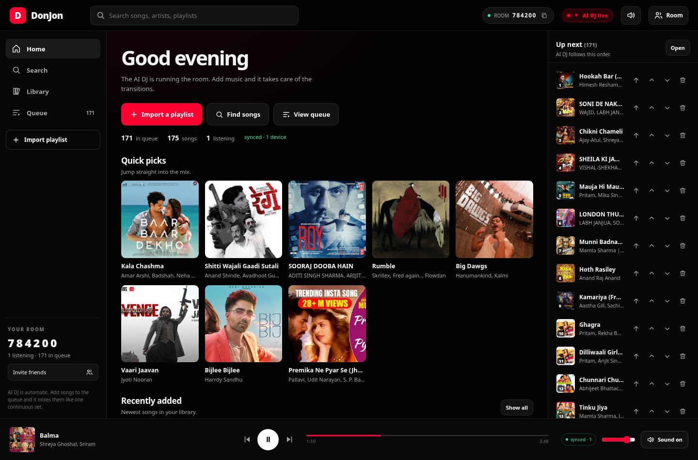
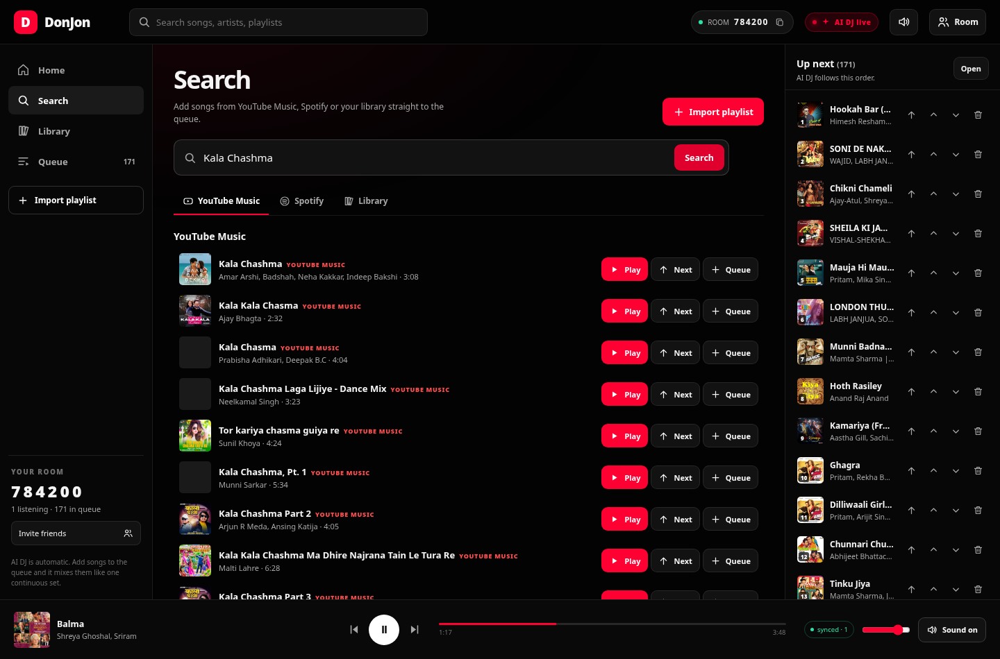
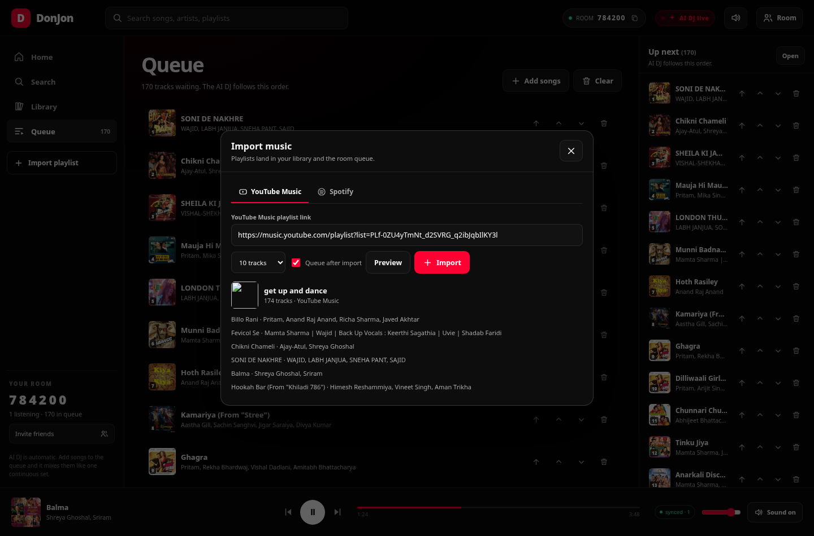
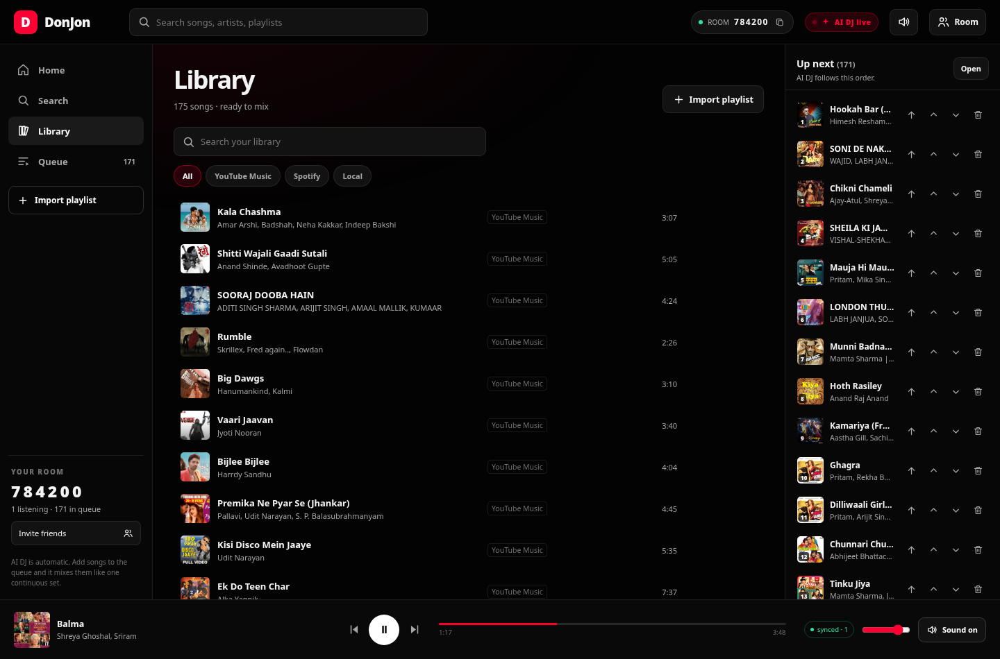
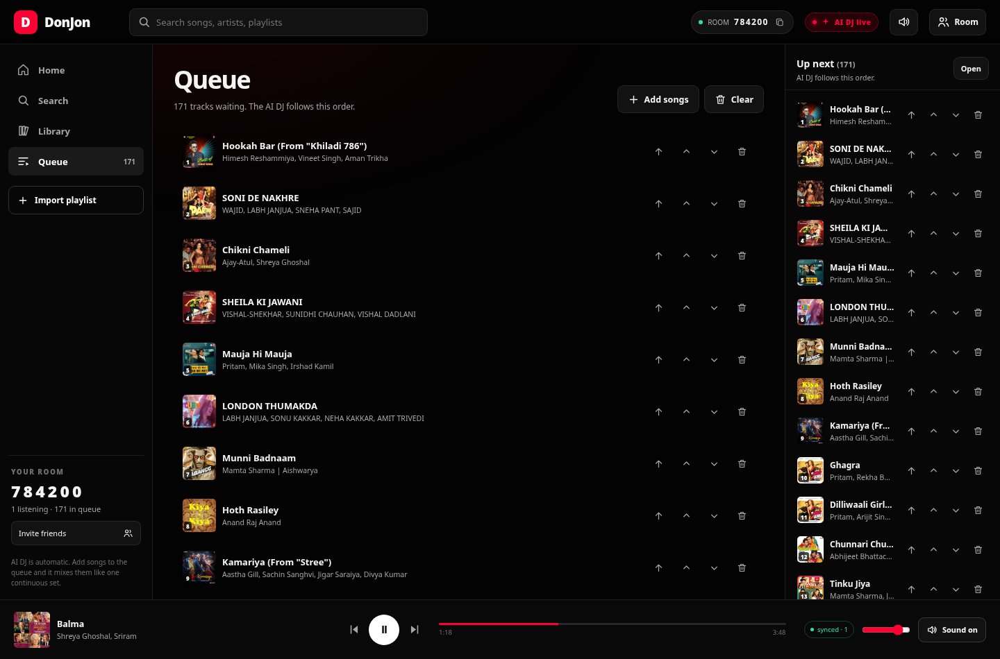
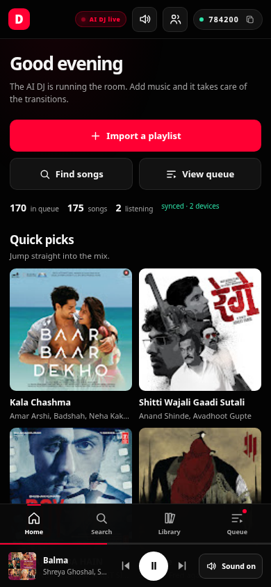

# DonJon — YouTube Music–style party player with an always-on AI DJ

**One room. One mix. Every speaker.**

DonJon turns a laptop into a shared party player. Friends open a web page, join a
six-digit room, add songs or import a playlist, and the AI DJ keeps one continuous
set going — beat-matched, bass-swapped, phrase-aligned transitions handled by a real
mixer, not a playlist with a crossfade.

The interface is deliberately simple and YouTube Music–like: **Home, Search, Library,
Queue**, one player bar, and nothing to configure. The professional machinery runs
behind the curtain.



## What it does

- **One shared room** — every phone/laptop joins with a six-digit code and hears the
  same mix, scheduled on its own audio clock. A per-device delay slider compensates
  for Bluetooth speakers.
- **Always-on AI DJ** — 16-bar blends with beat sync, low/mid/high EQ swaps at the
  drop, a filter sweep on the outgoing track, 4-beat loop fills and riser/impact
  overlays. No mode switch, no deck controls in the UI.
- **Section-aware playback** — each imported track is analysed for intro, first drop,
  outro and a DJ mix-in/mix-out window. The next track starts eight bars before its
  drop; the bass swap lands on the drop.
- **Simple queue control** — play now, play next, reorder, remove, vote, clear.
  The AI DJ auto-advances through the queue and stops when it is empty.
- **YouTube Music first** — search with clean artists, album art and previews;
  playlists import via `ytmusicapi` and audio is downloaded with `yt-dlp`.
- **Spotify import** — search and import playlist metadata with your own free Spotify
  developer app; playback is matched to the local/YouTube library. Credentials are
  saved locally and survive refreshes/restarts.
- **Real thumbnails everywhere** — playlist art, search results, queue, player bar.
- **Refresh-safe** — the browser remembers your name and rejoins automatically; the
  server keeps the room, queue and player state.

| Search | Import |
| --- | --- |
|  |  |

| Library | Queue |
| --- | --- |
|  |  |

<p align="center">
  
</p>

## Quick start

### Requirements

- Linux (PipeWire or PulseAudio)
- Python 3.10+
- **Mixxx 2.5+** — the mixing engine
- FFmpeg (`ffmpeg`, `ffprobe`)
- Xvfb and `xdotool` — Mixxx runs on a private display
- ImageMagick (`import`, `convert`) — used to verify that a deck actually loaded
- gcc — builds a tiny HID stub so Mixxx cannot hang scanning USB-HID devices

Arch Linux:

```bash
sudo pacman -S python ffmpeg mixxx libpulse xorg-server-xvfb xdotool gcc imagemagick
```

Debian/Ubuntu equivalents:

```bash
sudo apt install python3 python3-venv ffmpeg mixxx pulseaudio-utils \
    xvfb xdotool gcc imagemagick
```

### Run

```bash
git clone https://github.com/arnavpadwal/donjon-ai-dj.git
cd donjon-ai-dj
./start.sh
```

`start.sh` creates `.venv`, installs `backend/requirements.txt`, prints the LAN URL
and a random six-digit room code, then serves the app on **http://localhost:8080**.

- **Host:** open `http://localhost:8080`
- **Guests:** open `http://<your-lan-ip>:8080` and enter the room code
- Pin a code for the night: `DONJON_ROOM=482913 ./start.sh`
- Change the port: `DONJON_PORT=9000 ./start.sh`

The first launch creates an isolated Mixxx profile under `mixxx_profile/` (ignored by
Git). Your own Mixxx library and settings are never touched.

## Using it

1. **Join** with a name. Sound is on by default; browsers that block autoplay show a
   **Sound** button — one tap is enough.
2. **Import a playlist** from YouTube Music or Spotify, or search for individual
   songs. Imports land in the library and (optionally) replace the room queue.
3. **Play / pause / next / restart** from the player bar. The AI DJ follows the queue.
4. **Reorder the queue** with the arrow buttons, promote an item with **play next**, or
   remove it with the trash icon.
5. **Invite friends** from the Room drawer: copy the code or the LAN link. The drawer
   also has the synced-audio controls, a Bluetooth delay slider and a beep test.

### Spotify (optional)

1. Create a free app at <https://developer.spotify.com/dashboard>.
2. Open **Import → Spotify** in DonJon, paste the Client ID and Client Secret, and
   press **Save & test**.
3. The credentials are stored in `data/spotify.json` (ignored by Git) and are shown as
   “Spotify connected” after a refresh. Use **Forget** to remove them.

Spotify is used for metadata and playlist import only. Playback is matched to a local
file or a YouTube Music audio download, because the Spotify Web API does not stream
audio to third-party players.

## How the AI DJ works

```
Browser  ◄── WebSocket: room state + 50 ms PCM frames ──►  FastAPI
                                                            │
                                    keyboard mapping on Xvfb│
                                                            ▼
                                                    Mixxx 2.5 (2 decks)
                                                            │
                                     PulseAudio null sink   │
                                                            ▼
                                       ffmpeg capture ──► DONJ frames
```

- **Mixxx is the mixer.** It provides beat sync, time-stretching, EQ, filters, loops and
  samplers. DonJon drives it through a custom keyboard mapping on a private Xvfb
  display, so the host's browser keeps focus.
- **A 16-bar blend.** The incoming track is loaded at its `mix_in` cue (eight bars
  before its drop) and started silently. The crossfader moves over eight bars while the
  outgoing bass stays intact; at the halfway point the bass swaps to the incoming
  track, an impact sample fires, and the outgoing track is filtered and stopped.
- **Phrase alignment.** Cues are rounded to four-beat phrases. The next track is
  time-stretched by Mixxx's sync engine, so the drop lands on the swap.
- **Section analysis.** A NumPy RMS envelope finds the intro, first sustained drop,
  outro and the mix window. Results are stored in SQLite; `analysis_candidates` keeps
  backfilling new imports in the background.
- **Verification and recovery.** After every load DonJon checks the deck waveform
  (ImageMagick) and retries or double-clicks the library row if the load did not land.
  A watchdog also resets faders/crossfader — or reloads a deck — if a playing deck has
  been digitally silent for 12 seconds.

### Synced audio

Mixxx's master output goes to a PulseAudio null sink (`donjon_master`). FFmpeg captures
its monitor, splits it into 50 ms stereo PCM frames, and the server stamps each frame
with a fixed-cadence timestamp. Browsers schedule frames on a shared clock estimated
over the room WebSocket (NTP-style ping/pong), with a small jitter buffer and a
per-device offset. Pausing, seeking and transitions are explicit in the room state, not
inferred from the audio stream.

## Project structure

```
backend/
  config.py     paths, 6-digit room code, keymap, audio constants, Camelot wheel
  db.py         SQLite schema/migrations: tracks, playlists, artwork, section cues
  library.py    library scan, YT Music search/import, yt-dlp download, analysis
  mixxx.py      headless Mixxx, keyboard automation, transitions, deck verification
  autodj.py     queue, AI selection, room state, jobs, auto-advance loop
  audio.py      Pulse monitor capture and DONJ WebSocket frame stream
  spotify.py    Spotify credentials/status/search/playlist metadata
  main.py       FastAPI REST + WebSocket hub + job runner
frontend/
  index.html    YTM-like shell: Home / Search / Library / Queue / Room drawer
  app.js        room socket, audio scheduler, search, imports, queue, player
  style.css     responsive dark theme + mobile bottom navigation
fx/             four synthesized DJ overlays (riser, impact, clap, horn)
tests/          dependency-free unit tests
data/           runtime only (DB, artwork cache, Spotify credentials, logs) — ignored
library/        downloaded audio — ignored
mixxx_profile/  isolated Mixxx profile and DB — ignored
```

## API sketch

| Endpoint | Purpose |
| --- | --- |
| `GET /api/state` | Room, queue, decks, audio, jobs |
| `POST /api/youtube/search` | YouTube Music search with thumbnails |
| `POST /api/youtube/playlist` | Preview a playlist (all tracks + artwork) |
| `POST /api/youtube/playlist/import` | Import/download a playlist, optionally queue it |
| `POST /api/youtube/track?action=now\|next\|queue` | Download and play/queue one song |
| `GET/POST /api/spotify/*` | Status, credentials, search, playlist import |
| `GET /api/library`, `POST /api/library/import` | Library list/import |
| `POST /api/playlists/{id}/queue?replace=true` | Replace the room queue from a playlist |
| `GET /api/playlists` | Playlists with tracks and artwork |
| `WS /ws/room/{code}` | Room state, presence, actions, clock sync |
| `WS /ws/audio/{code}` | Binary `DONJ` PCM frames |

## Testing

The dependency-free logic suite covers the Camelot wheel, harmony scoring, 6-digit room
codes, text cleaning, queue priority/reorder/vote, the PCM frame header, DB migrations
and the keyboard-map safety rules:

```bash
.venv/bin/python -m unittest discover -s tests -v
```

Latest run: **7 tests, all passing.**

The UI was also exercised end-to-end with Playwright at 1440×950 and 390×844:
join/auto-rejoin, synced audio scheduling (50 ms frames, zero gaps), search and
thumbnails, playlist preview (174 tracks), queue reorder/restore, pause/resume,
browser-triggered transitions, refresh persistence and no horizontal overflow on
mobile.

## Troubleshooting

- **No sound in the browser:** click **Sound**. Browsers require a gesture before
  creating/resuming an `AudioContext`.
- **“AI DJ booting”:** Mixxx is still starting or did not get an audio device. Check
  `data/mixxx.log` and that `pactl list sinks short` shows `donjon_master`.
- **A track sounds out of time:** the BPM/key analyser is approximate on unusual
  material. Edit the BPM/key in the library, or delete and re-import the file.
- **Mixxx window/focus issues:** keep the app on the virtual display it creates; do not
  run a second Mixxx with the same `mixxx_profile`.
- **ImageMagick missing:** the deck-load check is skipped, but playback still works;
  install `imagemagick` for reliable loads.

## Legal & responsible use

Downloading audio from YouTube may violate YouTube's Terms of Service and copyright
law in your country. Use DonJon only with music you own or have permission to use, and
do not redistribute the downloaded files. Spotify credentials are stored locally and
never committed; `data/`, `library/` and `mixxx_profile/` are in `.gitignore`.

DonJon is a personal/party project, not a commercial streaming service. Mixxx is
licensed separately; see its own repository for terms.
